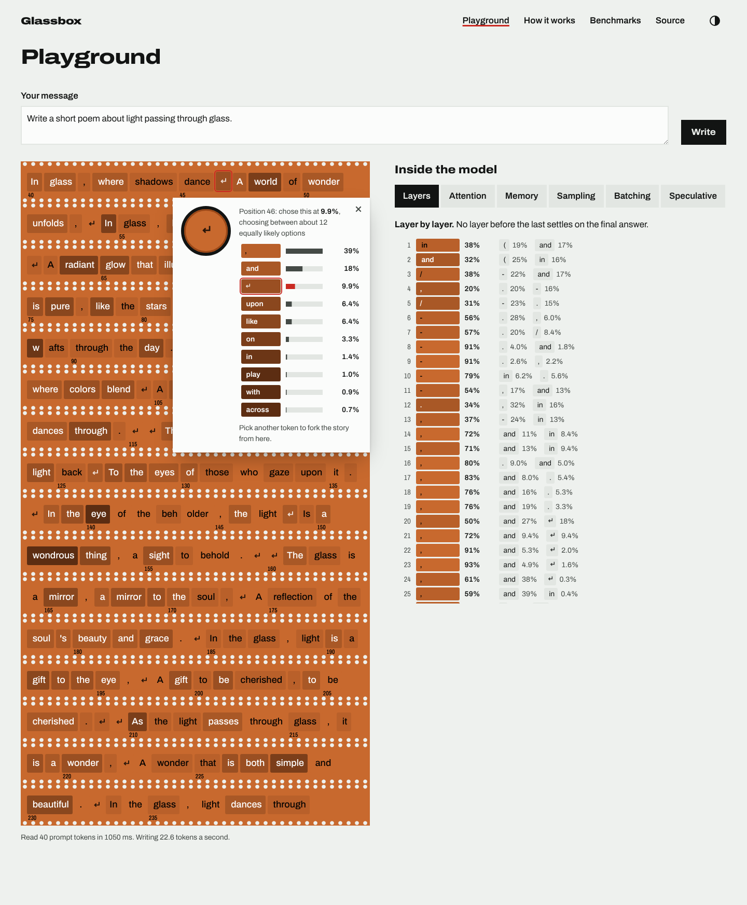
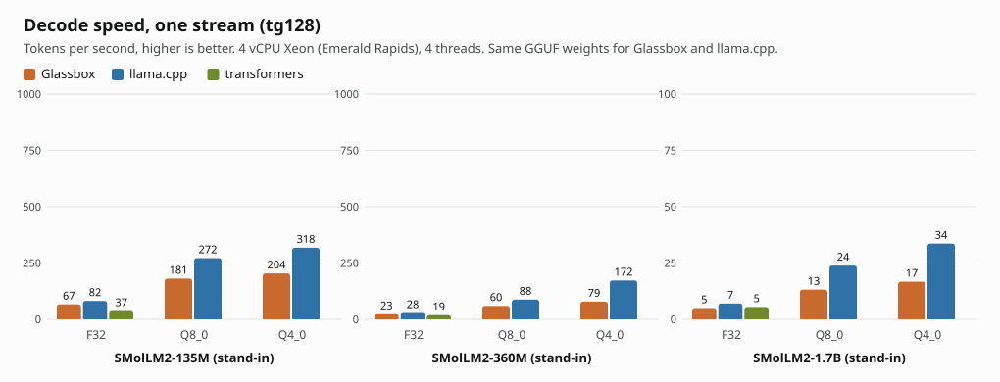
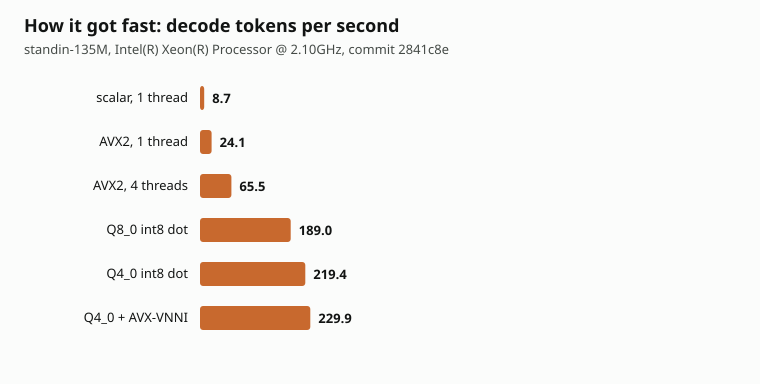
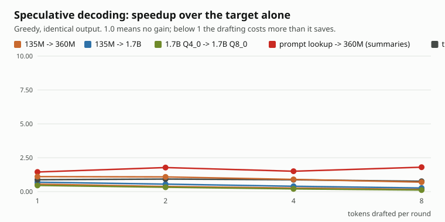

# Glassbox

An LLM inference engine written from scratch in Rust, and a web app that shows what happens inside the model while it writes. The same engine runs natively as an OpenAI-compatible server and, compiled to WebAssembly, in your browser: every token on the screen comes with its probability, the ten tokens the model almost wrote instead, what each of its layers was predicting, where it was looking, and how its memory filled up.

No ML framework: the tokenizer, the SIMD kernels, quantization, the paged KV cache, continuous batching, speculative decoding and JSON-schema constrained output are all in this repository, and every number below comes from a script in it.



**Live demo:** https://rudrasomaiya.github.io/glassbox/ (the model downloads once, 269 MB, and runs on your machine)

> **About the weights in these numbers.** The speed benchmarks were measured on models with SmolLM2's exact shapes and random weights, while Hugging Face was out of reach from the build machine; speed depends only on the shapes. Correctness checks, perplexity, speculative decoding, the screenshots and the recorded replays use the real SmolLM2 Instruct checkpoints.

## What's in it

- **Tokenizer:** byte-level BPE read from `tokenizer.json`, pre-tokenizer and special tokens included. Identical to Hugging Face `tokenizers` on 2,175 test strings (English, code, emoji, Hindi, Hinglish, whitespace).
- **Model:** Llama family (RMSNorm, RoPE, grouped-query attention, SwiGLU, tied or untied head), from safetensors or GGUF. Logits match Hugging Face `transformers` in f32 to within 4.5e-6, and 64-token greedy continuations are identical on 21 prompts.
- **Kernels:** f32, Q8_0 and Q4_0 matrix multiplication with AVX2+FMA and AVX-VNNI (picked at runtime) and WebAssembly SIMD, each checked against a scalar version. Register-tiled, prefetching, on a spinning thread pool.
- **Quantization:** GGUF-compatible Q8_0 and Q4_0. The Q8_0 quantizer produces bit-identical blocks to llama.cpp's; perplexity on the same files matches llama.cpp's to four decimal places in f32 (7.7685 for 135M, 5.8766 for 360M).
- **KV cache:** paged in 16-token blocks with reference counts, copy-on-write forks and automatic prefix sharing.
- **Server:** continuous batching with chunked prefill and preemption, OpenAI-compatible `/v1/chat/completions` and `/v1/completions` with streaming, `/metrics` for Prometheus, `/v1/trace` to record a run for the web app.
- **Speculative decoding:** draft model or prompt lookup, with rejection sampling that keeps the output distribution exactly the target's (tested by a chi-square test).
- **Constrained decoding:** `response_format: {type: "json_schema"}` compiled to a byte-level state machine over a token trie. 200 random schemas, every output valid.
- **The glass box:** a React app with the token stream (fork the story at any token), layer-by-layer predictions, attention heads, the KV cache, live sampling dials, and replays of batching and speculative decoding.

## Benchmarks

One machine: a 4-vCPU cloud VM (Intel Xeon, Emerald Rapids, AVX-512 available), 4 threads, no GPU. llama.cpp built from source (commit `0c1e570`, native flags) reads the same GGUF bytes. Method, raw JSON and charts in [`bench/`](bench/results).



| SmolLM2 shapes | Glassbox decode | llama.cpp decode | Glassbox prefill | llama.cpp prefill |
|---|---|---|---|---|
| 135M Q8_0 | 181 tok/s | 272 tok/s | 296 tok/s | 2,416 tok/s |
| 360M Q8_0 | 60 tok/s | 88 tok/s | 157 tok/s | 988 tok/s |
| 1.7B Q8_0 | 13 tok/s | 24 tok/s | 44 tok/s | 226 tok/s |

Decode, where memory bandwidth decides, runs at 50-80% of llama.cpp's speed. Prompt processing is 5-8x slower: llama.cpp uses 512-bit VNNI kernels over repacked weight layouts, and Glassbox runs 256-bit dot products (AVX-VNNI where the CPU has it) over the original layout. In f32 Glassbox decodes faster than `transformers` (67 vs 37 tok/s at 135M).

How it got fast, decode on the 135M shapes:



Serving, 48 chat-sized requests (prompts 32-320 tokens, replies 32-256) arriving as a Poisson process, 135M shapes at Q8_0:

| arrivals | continuous batching: tokens/s, TTFT p50 / p99 | one request at a time: tokens/s, TTFT p50 / p99 |
|---|---|---|
| 0.5 req/s | 66, 0.7 s / 1.9 s | 66, 3.1 s / 10.8 s |
| 1 req/s | 98, 1.6 s / 8.5 s | 79, 20.7 s / 36.3 s |
| 2 req/s | 109, 3.8 s / 24.0 s | 82, 31.5 s / 57.8 s |

Above about 1 request a second the engine is saturated: batched decode is limited by the same matrix kernel that makes prefill slow. With a shared 384-token system prompt at 2 requests a second, the prefix cache cuts median time to first token from 26.3 s to 0.23 s and triples throughput (23 to 71 tokens/s).

Speculative decoding (greedy, output identical to the target alone; speedup in decode time):



It pays off where the drafter is much cheaper than the target: 135M drafting for 1.7B is accepted 62-68% of the time and gives 1.24x with one or two drafted tokens. Drafting for 360M (only 3x the cost of 135M) loses at 0.75x despite 70% acceptance, and a 4-bit copy of 1.7B agrees 85% of the time but is too expensive to draft with (0.75x). Prompt lookup on summaries loses too (0.90x): the real model paraphrases rather than copying the passage. Longer drafts never help here, because checking several tokens in one pass is not free on this CPU: two tokens cost about 1.6 times one, since the kernel is compute-bound.

In headless Chromium on the same VM, single-threaded WebAssembly runs the 135M shapes at Q8_0 at 23.8 tokens per second (laptops will differ; this is a headless 4-vCPU VM).

## Quick start

```bash
scripts/download_models.sh 135M          # SmolLM2-135M-Instruct from Hugging Face into models/
cargo build --release
```

Chat in the terminal:

```bash
./target/release/glassbox chat --model models/SmolLM2-135M-Instruct --dtype q8_0
```

Run the server and call it with the official OpenAI client:

```bash
./target/release/glassbox serve --model models/SmolLM2-135M-Instruct --dtype q8_0 --port 8080
```

```bash
uv run --with openai python examples/openai_client.py
```

Ask for JSON that matches a schema; the reply always parses and validates:

```python
reply = client.chat.completions.create(
    model=model,
    messages=[{"role": "user", "content": "Describe the film Interstellar as JSON."}],
    response_format={"type": "json_schema", "json_schema": {"name": "film", "schema": {
        "type": "object",
        "properties": {
            "name": {"type": "string", "maxLength": 40},
            "year": {"type": "integer"},
            "genres": {"type": "array", "items": {"enum": ["drama", "comedy", "sci-fi"]}, "maxItems": 3},
        },
        "required": ["name", "year", "genres"],
    }}},
)
```

(full script: [`examples/json_schema.py`](examples/json_schema.py))

The web app:

```bash
scripts/build_wasm.sh
cd web && npm install && npm run dev
```

## Architecture

```
            text ──► tokenizer ──► ids
                                    │
     ┌──────────────────────────────▼───────────────────────────────┐
     │ Model::forward(tokens, positions, sequences, want, cache)     │
     │   embed ─► [ RMSNorm ─► QKV ─► RoPE ─► paged KV write         │
     │             ─► attention over block tables ─► out-proj        │
     │             ─► RMSNorm ─► SwiGLU MLP ] x N layers ─► LM head  │
     │   kernels: AVX2 / WASM SIMD, f32 · Q8_0 · Q4_0, thread pool   │
     └───────▲──────────────────▲─────────────────────▲──────────────┘
             │                  │                     │
     CLI and tests        glassbox-server        glassbox-wasm
     (Generator)     scheduler: continuous     Web Worker, one
                     batching, preemption,     sequence, traces
                     prefix cache, spec        on demand
                     decoding, JSON schema
                     OpenAI API + SSE
```

Details in [`docs/ARCHITECTURE.md`](docs/ARCHITECTURE.md); how it was built and what surprised me in [`docs/WRITEUP.md`](docs/WRITEUP.md).

## Correctness

- `cargo test` runs kernel-vs-scalar tests, KV cache tests, scheduler property tests (batched output equals unbatched, no leaked blocks after random finishes, aborts and preemptions, prefix sharing never changes output), speculative decoding tests (greedy identical to the target alone, chi-square on sampled output) and 200 random JSON schemas, all on tiny random models so CI needs no downloads.
- With models present, `tools/reference/make_golden.py` writes fixtures from `transformers` and the golden tests check logits, greedy continuations and tokenizer ids against them.
- `web/tests/wasm-parity.mjs` runs the WebAssembly build in headless Chromium and checks it reproduces the native greedy output.

## Reproduce

```bash
scripts/download_models.sh 135M 360M 1.7B
(cd tools/reference && uv run python make_golden.py && uv run python to_gguf.py ../../models/SmolLM2-*)
cargo test --release                          # includes the golden tests now that models exist
scripts/build_llamacpp.sh
scripts/bench_single.sh models/SmolLM2-135M-Instruct smollm2-135m
./target/release/glassbox-bench progression --model models/SmolLM2-135M-Instruct --out bench/results/progression.json
./target/release/glassbox-bench serve --model models/SmolLM2-135M-Instruct --out bench/results/serving.json
SMALL=models/SmolLM2-135M-Instruct BIG=models/SmolLM2-1.7B-Instruct scripts/record_traces.sh
python3 tools/reference/charts.py
```

## Limitations

- Slower than llama.cpp everywhere, and much slower at prompt processing (no 512-bit kernels or repacked GEMM yet).
- CPU only. The browser build is single-threaded.
- The speed benchmarks were measured on random weights with SmolLM2's shapes; see the note at the top.
- JSON schema support is a practical subset: object, array, string, number, integer, boolean, null, enum, nesting. Objects are written with every listed property, in schema order.
- One architecture family (Llama). Qwen3 (QK-norm) is not done.

## Licence

MIT
